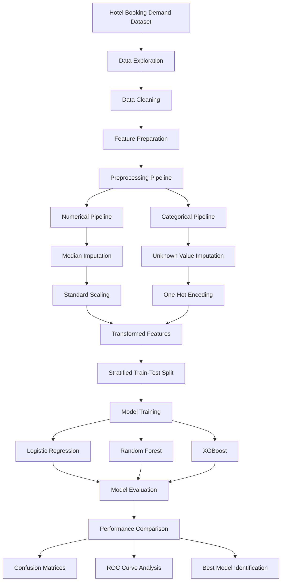
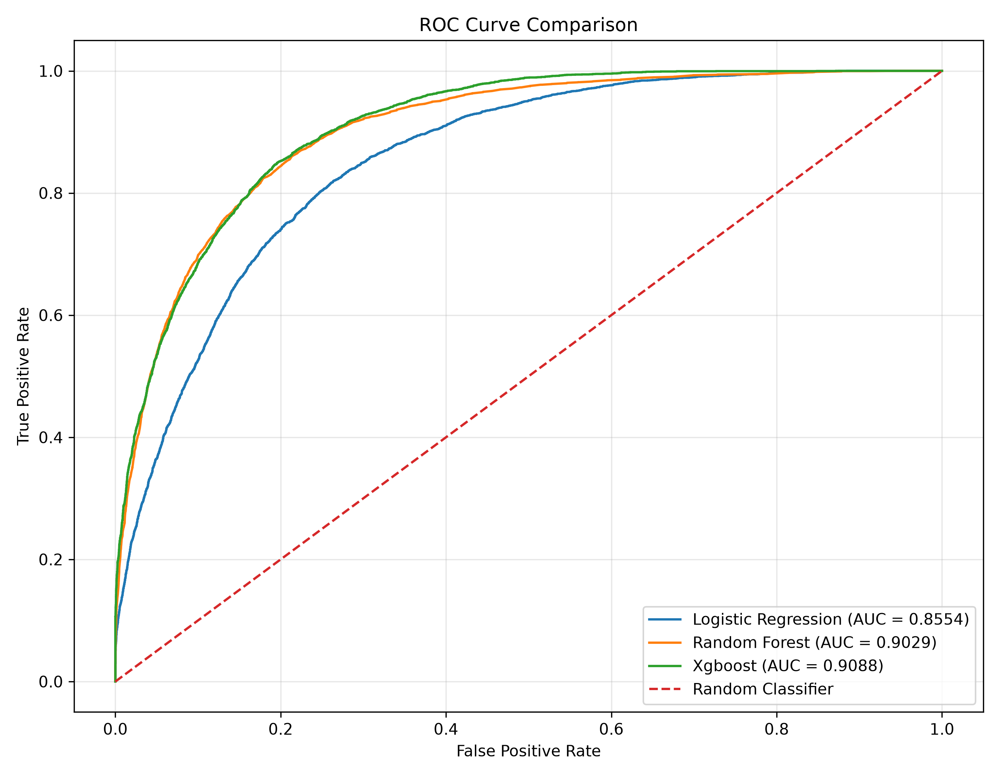
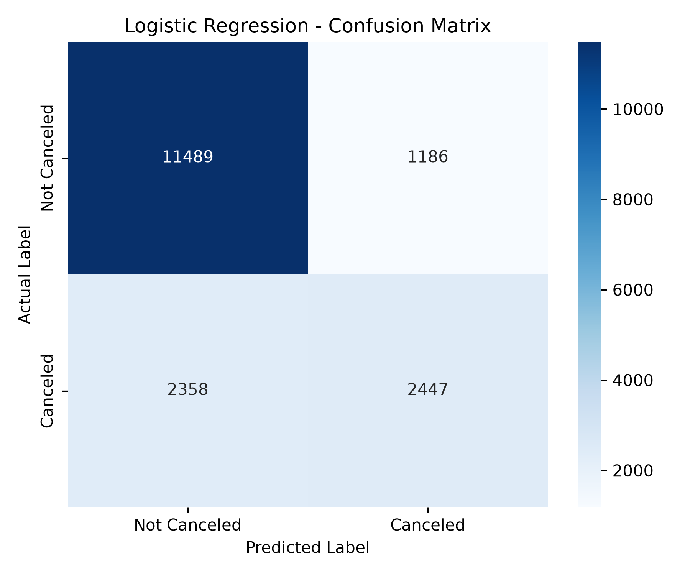
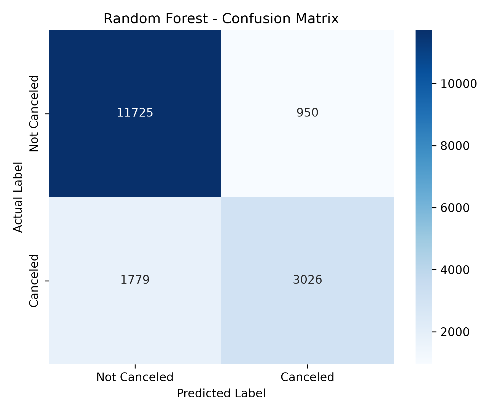
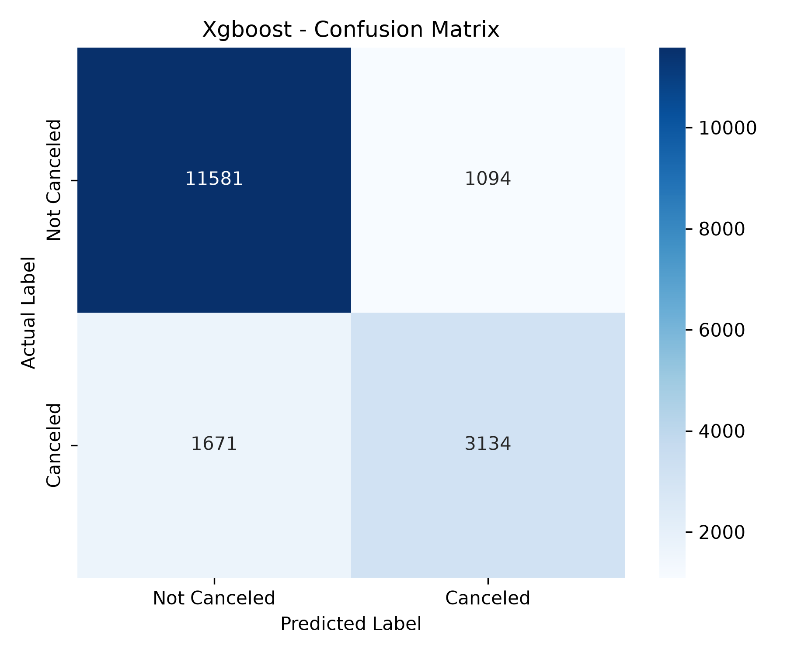

# StayWise

### Predictive Intelligence for Hotel Revenue Protection

<p align="center">
  <strong>Turning Historical Booking Data into Intelligent Cancellation Insights.</strong>
</p>

<p align="center">
  
  
  
  
  
</p>

---

## Overview

**StayWise** is a machine learning project designed to analyze hotel booking patterns and identify the likelihood of booking cancellations using historical reservation data.

Booking cancellations represent a significant operational challenge for the hospitality industry. They can lead to revenue uncertainty, inefficient room allocation, and difficulties in planning hotel operations.

StayWise approaches this problem through supervised machine learning, implementing and comparing three classification algorithms to understand how effectively historical booking characteristics can distinguish between cancelled and non-cancelled reservations.

The project covers the complete model development and evaluation workflow, including data cleaning, preprocessing, feature transformation, model training, performance analysis, and comparative evaluation.

### Model Highlights

| Metric        | Best Result | Model         |
| ------------- | ----------: | ------------- |
| Test Accuracy |      84.39% | Random Forest |
| F1-Score      |      83.90% | Random Forest |
| ROC-AUC       |      90.88% | XGBoost       |

**Three algorithms. One comparative evaluation. A data-driven approach to understanding hotel cancellations.**

---

## Problem Statement

Hotel booking cancellations introduce uncertainty into revenue forecasting and operational planning.

When a reservation is cancelled, hotels may experience unused room inventory, revenue losses, and difficulties in managing available resources.

The objective of StayWise is to develop and evaluate machine learning classification models that can identify cancellation patterns from historical booking information.

The project formulates cancellation prediction as a binary classification problem using the `is_canceled` target variable.

- `0` — Booking Not Cancelled
- `1` — Booking Cancelled

---

## Project Objectives

- Analyze historical hotel booking data to understand cancellation patterns.
- Clean and prepare raw booking records for machine learning.
- Develop a reusable preprocessing pipeline for numerical and categorical features.
- Apply multiple supervised classification algorithms.
- Compare model performance using standard evaluation metrics.
- Analyze model generalization through training and testing performance.
- Visualize classification performance using confusion matrices and ROC curves.
- Identify the most suitable model based on comparative evaluation.

---

## Dataset

The project uses the **Hotel Booking Demand Dataset**, published by Jesse Mostipak on Kaggle.

**Source:** [Hotel Booking Demand Dataset — Kaggle](https://www.kaggle.com/datasets/jessemostipak/hotel-booking-demand)

The dataset contains historical booking information from two hotel categories:

- City Hotel
- Resort Hotel

It includes reservation characteristics, customer information, booking channels, arrival details, and other attributes that may influence cancellation behavior.

### Dataset Statistics

| Description               | Records |
| ------------------------- | ------: |
| Original dataset          | 119,390 |
| Duplicate records removed |  31,994 |
| Final dataset             |  87,396 |
| Training samples          |  69,916 |
| Testing samples           |  17,480 |
| Transformed features      |     558 |

### Important Dataset Attributes

Some of the important variables include:

| Feature                     | Description                      |
| --------------------------- | -------------------------------- |
| `hotel`                     | Type of hotel                    |
| `lead_time`                 | Days between booking and arrival |
| `arrival_date_month`        | Month of arrival                 |
| `stays_in_weekend_nights`   | Weekend nights booked            |
| `stays_in_week_nights`      | Weekday nights booked            |
| `adults`                    | Number of adults                 |
| `children`                  | Number of children               |
| `previous_cancellations`    | Previous cancelled bookings      |
| `market_segment`            | Booking market segment           |
| `deposit_type`              | Type of deposit                  |
| `customer_type`             | Type of customer                 |
| `adr`                       | Average Daily Rate               |
| `total_of_special_requests` | Number of special requests       |

**Target variable:** `is_canceled`

---

## Technology Stack

| Technology   | Application                           |
| ------------ | ------------------------------------- |
| Python       | Core development                      |
| Pandas       | Data manipulation                     |
| NumPy        | Numerical operations                  |
| Scikit-learn | Preprocessing and machine learning    |
| XGBoost      | Gradient boosting classification      |
| SciPy        | Sparse matrix storage                 |
| Matplotlib   | Visualization                         |
| Seaborn      | Statistical visualization             |
| Joblib       | Model serialization                   |
| uv           | Dependency and environment management |

---

## Machine Learning Workflow

StayWise follows a structured machine learning pipeline, from raw dataset preparation to model evaluation.



---

## Data Preprocessing

A reusable preprocessing pipeline was developed using Scikit-learn to ensure consistent transformations across training and testing datasets.

### 1. Data Cleaning

- Removed duplicate records using Pandas.
- Removed selected columns that were excluded from model training.
- Separated the input features from the target variable.

The following columns were excluded:

- `reservation_status`
- `reservation_status_date`
- `booking_changes`
- `assigned_room_type`
- `company`

### 2. Missing Value Imputation

Missing values were handled separately for numerical and categorical attributes.

| Feature Type | Strategy                            |
| ------------ | ----------------------------------- |
| Numerical    | Median imputation                   |
| Categorical  | Constant imputation using `Unknown` |

### 3. Categorical Feature Encoding

Categorical variables were transformed using **One-Hot Encoding**.

This converts categorical values into numerical feature representations suitable for machine learning algorithms.

The encoder also uses `handle_unknown="ignore"` to handle previously unseen categories during transformation.

### 4. Numerical Feature Scaling

Numerical attributes were standardized using **StandardScaler**.

This transformation helps numerical features operate on comparable scales.

### 5. Train-Test Split

The dataset was divided into training and testing subsets using an 80:20 split.

Stratified sampling was used to preserve the target class distribution across both subsets.

| Subset   | Samples | Split |
| -------- | ------: | ----: |
| Training |  69,916 |   80% |
| Testing  |  17,480 |   20% |

A fixed random state of `42` was used for reproducibility.

### 6. Transformation Artifacts

The fitted preprocessing pipeline and transformed datasets were saved for reuse.

- `preprocessor.joblib` — Fitted preprocessing pipeline.
- `X_train.npz` — Transformed training features.
- `X_test.npz` — Transformed testing features.
- `y_train.npy` — Training target values.
- `y_test.npy` — Testing target values.
- `feature_names.json` — Transformed feature names.

The resulting feature representation contains **558 features**.

---

## Machine Learning Models

Three classification algorithms were implemented and trained independently.

### 1. Logistic Regression

Logistic Regression serves as the baseline classification model.

It estimates the probability of a booking belonging to a particular class using a linear decision function.

**Configuration:**

- Maximum iterations: 1000
- Random state: 42

### 2. Random Forest Classifier

Random Forest is an ensemble learning algorithm that combines predictions from multiple decision trees.

It can capture nonlinear relationships and interactions between booking characteristics.

**Configuration:**

- Number of estimators: 200
- Parallel processing: Enabled
- Random state: 42

### 3. XGBoost Classifier

XGBoost is a gradient boosting algorithm that builds decision trees sequentially to improve predictive performance.

It is particularly effective for structured tabular datasets.

**Configuration:**

- Number of estimators: 300
- Maximum tree depth: 6
- Learning rate: 0.05
- Subsample: 0.8
- Column subsample: 0.8
- Objective: Binary Logistic
- Evaluation metric: Log Loss
- Tree method: Histogram

---

## Model Evaluation

All three trained models were evaluated using the same training and testing datasets.

The following metrics were calculated:

| Metric    | Purpose                                                             |
| --------- | ------------------------------------------------------------------- |
| Accuracy  | Measures overall classification correctness                         |
| Precision | Measures how many predicted cancellations were actually cancelled   |
| Recall    | Measures how many actual cancellations were correctly identified    |
| F1-Score  | Balances precision and recall                                       |
| ROC-AUC   | Measures the model's ability to distinguish between the two classes |

Additionally, training and testing metrics were compared to understand model generalization.

The evaluation pipeline also generates:

- Individual classification reports.
- Confusion matrices for each model.
- Combined ROC curve visualization.
- Training and testing metric comparisons.
- Training-testing accuracy gaps.
- Model evaluation time.

---

## Performance Comparison

The following table presents the testing performance obtained by the three models.

| Model               |   Accuracy |   F1-Score |    ROC-AUC |
| ------------------- | ---------: | ---------: | ---------: |
| Logistic Regression |     79.73% |     78.77% |     85.54% |
| Random Forest       | **84.39%** | **83.90%** |     90.29% |
| XGBoost             |     84.18% |     83.85% | **90.88%** |

### Key Findings

**Logistic Regression**

- Establishes a baseline for cancellation classification.
- Provides lower performance compared to the two ensemble models.

**Random Forest**

- Achieves the highest test accuracy of 84.39%.
- Achieves the highest F1-score of 83.90%.
- Provides strong overall classification performance.

**XGBoost**

- Achieves the highest ROC-AUC of 90.88%.
- Demonstrates strong class-discrimination capability.
- Provides competitive accuracy and F1-score.

### Model Selection

XGBoost is identified as the preferred model based on the highest testing ROC-AUC, while Random Forest achieves the best testing accuracy and F1-score.

The comparison highlights that the best-performing model can depend on the evaluation metric and the intended application.

---

## Evaluation Visualizations

Visual evaluation artifacts are generated and saved automatically during model evaluation.

### ROC Curve Comparison

The ROC curve compares the true positive rate against the false positive rate across different classification thresholds.

It helps assess the ability of each model to distinguish between cancelled and non-cancelled bookings.



### Confusion Matrices

Confusion matrices provide a detailed breakdown of correct and incorrect predictions for both classes.

**Logistic Regression**



**Random Forest**



**XGBoost**



### Classification Reports

Detailed classification reports are available for individual models:

- [Logistic Regression](results/classification_reports/logistic_regression.txt)
- [Random Forest](results/classification_reports/random_forest.txt)
- [XGBoost](results/classification_reports/xgboost.txt)

### Model Comparison Results

The complete numerical evaluation, including training and testing metrics, is stored in:

[`results/model_comparison.csv`](results/model_comparison.csv)

---

## Project Structure

```text
hotel-booking-cancellation-prediction/
│
├── dataset/
│   └── hotel_bookings.csv
│
├── data/
│   └── processed/
│       ├── feature_names.json
│       ├── preprocessor.joblib
│       ├── X_train.npz
│       ├── X_test.npz
│       ├── y_train.npy
│       └── y_test.npy
│
├── models/
│   ├── logistic_regression.joblib
│   ├── random_forest.joblib
│   └── xgboost.joblib
│
├── notebooks/
│   └── data_exploration.py
│
├── results/
│   ├── classification_reports/
│   │   ├── logistic_regression.txt
│   │   ├── random_forest.txt
│   │   └── xgboost.txt
│   │
│   ├── confusion_matrices/
│   │   ├── logistic_regression.png
│   │   ├── random_forest.png
│   │   └── xgboost.png
│   │
│   ├── roc_curves/
│   │   └── roc_curves.png
│   │
│   └── model_comparison.csv
│
├── src/
│   ├── hotel_booking_cancellation_prediction/
│   │   └── __init__.py
│   │
│   ├── preprocessing.py
│   ├── model_training.py
│   └── model_evaluation.py
│
├── pyproject.toml
├── uv.lock
└── README.md
```

---

## Installation and Setup

### Prerequisites

- Python 3.11 or later
- Git
- uv package manager

### 1. Clone the Repository

```bash
git clone <YOUR_GITHUB_REPOSITORY_URL>
cd hotel-booking-cancellation-prediction
```

### 2. Install uv

If uv is not installed:

```bash
curl -LsSf https://astral.sh/uv/install.sh | sh
```

### 3. Install Dependencies

```bash
uv sync
```

### 4. Activate the Virtual Environment

Linux/macOS:

```bash
source .venv/bin/activate
```

Windows:

```powershell
.venv\Scripts\activate
```

### 5. Execute the Project

Run the scripts sequentially from the project root.

**Preprocessing**

```bash
uv run python src/preprocessing.py
```

**Model Training**

```bash
uv run python src/model_training.py
```

**Model Evaluation**

```bash
uv run python src/model_evaluation.py
```

After successful execution, trained models and evaluation artifacts will be saved in their respective directories.

---

## Key Contributions

The primary contributions of StayWise include:

1. Developed a structured machine learning pipeline for hotel booking cancellation classification.
2. Processed a real-world dataset containing 119,390 original booking records.
3. Implemented a reusable Scikit-learn preprocessing pipeline combining numerical imputation, categorical imputation, One-Hot Encoding, and Standard Scaling.
4. Transformed the dataset into a 558-feature representation.
5. Implemented and trained three different classification algorithms.
6. Evaluated models using multiple classification metrics, including ROC-AUC.
7. Compared training and testing performance to analyze model generalization.
8. Automated the generation of confusion matrices, classification reports, and ROC curves.
9. Serialized trained models and preprocessing artifacts for reproducibility and future extensions.

---

## Future Improvements

Potential directions for extending StayWise include:

- **Interactive Prediction Interface:** Develop a Streamlit application for entering booking information and obtaining cancellation predictions.
- **Prediction Probability:** Display estimated cancellation probabilities alongside classification results.
- **Model Explainability:** Integrate SHAP to understand the influence of individual booking attributes on predictions.
- **Hyperparameter Optimization:** Explore Grid Search, Randomized Search, or Bayesian optimization to improve model performance.
- **Deployment:** Expose the selected model through a REST API.
- **Model Monitoring:** Track prediction performance and potential changes in booking patterns over time.

---

## Limitations

- The current implementation focuses on offline model training and evaluation.
- A dedicated user-facing prediction application has not been implemented.
- The evaluation is based on a held-out test dataset and does not establish real-world deployment performance.
- Model predictions are dependent on the quality and representativeness of the historical dataset.

---

## Author

**Punna Abhinav**

Atal Bihari Vajpayee Indian Institute of Information Technology and Management, Gwalior (ABV-IIITM Gwalior).

---

## Acknowledgements

Special thanks to Jesse Mostipak for making the Hotel Booking Demand Dataset publicly available on Kaggle.

**Dataset:** [Hotel Booking Demand — Kaggle](https://www.kaggle.com/datasets/jessemostipak/hotel-booking-demand)

---

<p align="center">
  <strong>StayWise</strong>
  <br/>
  Predicting Patterns. Understanding Cancellations. Enabling Smarter Hospitality.
</p>
